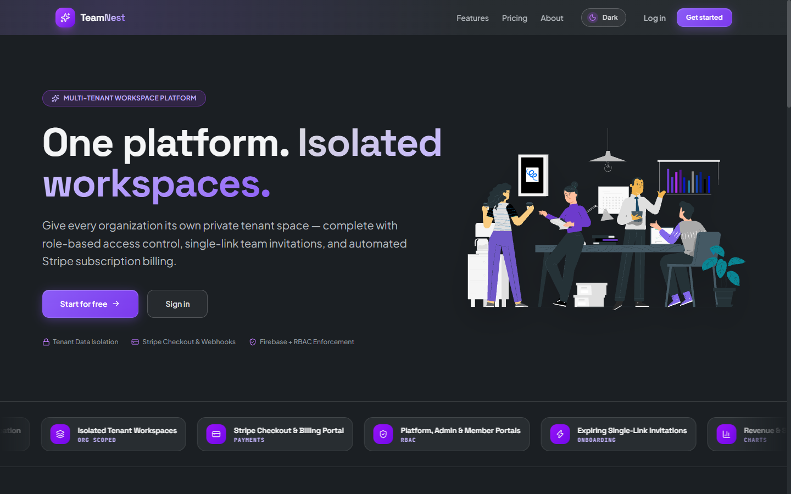
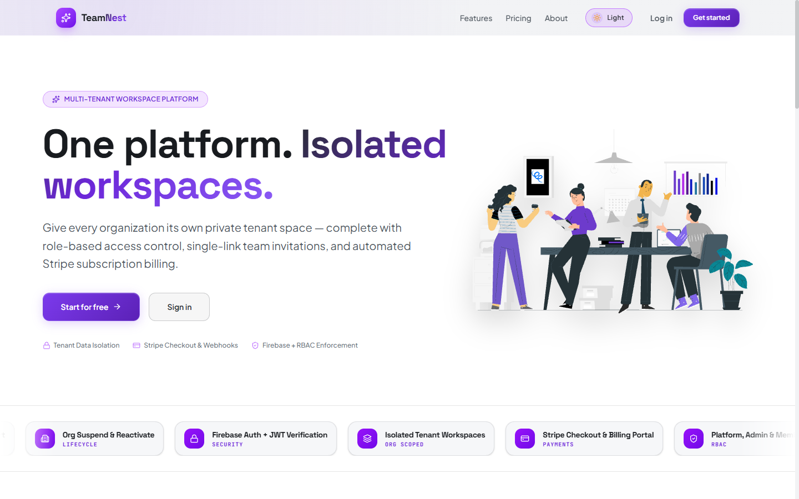
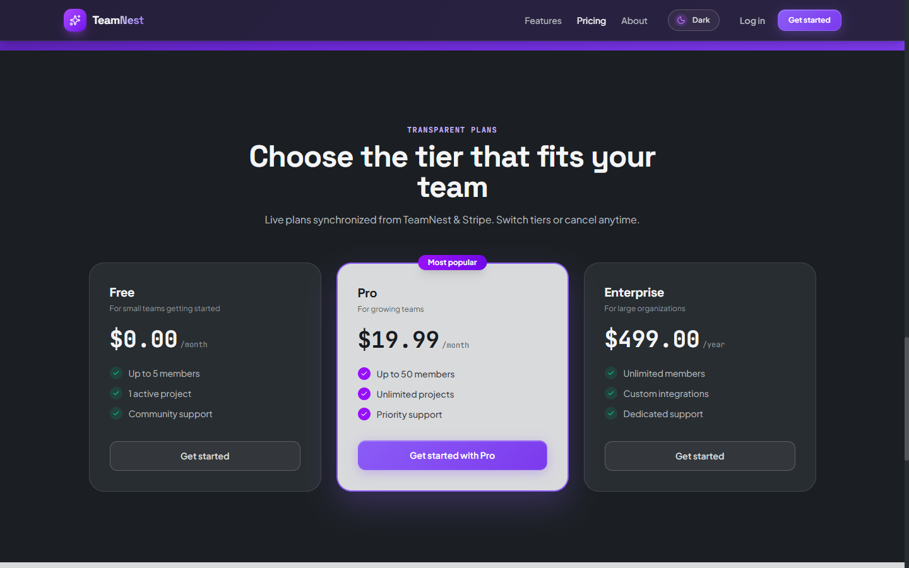
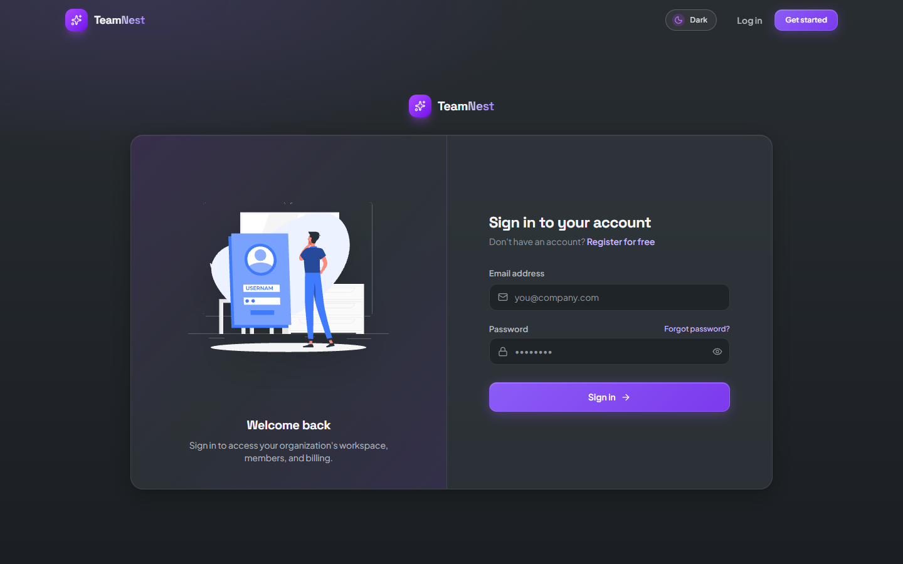
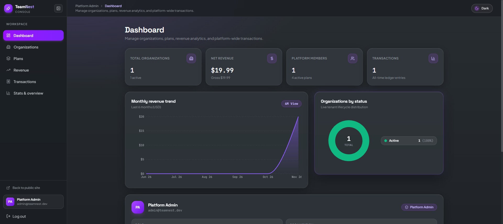
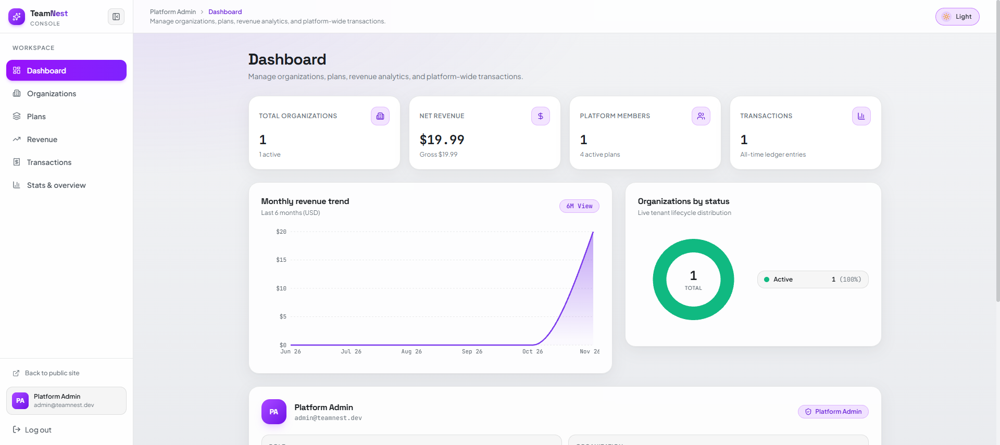
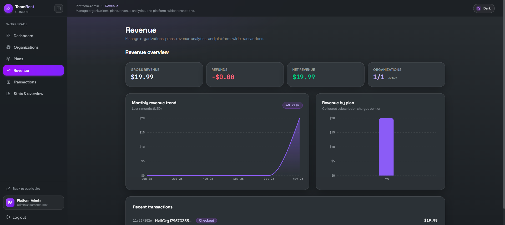
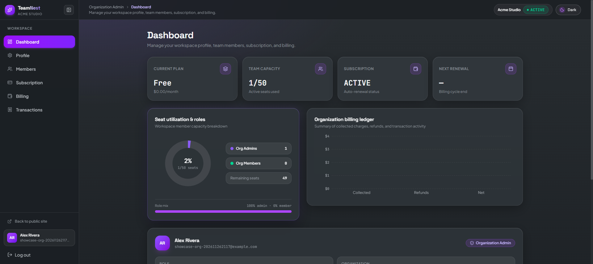

# TeamNest — Multi-Tenant SaaS Workspace & Billing Platform

**TeamNest** is a multi-tenant SaaS web application giving organizations their own isolated workspaces with role-based access control, tokenized team invitations, Stripe subscription billing, and interactive revenue/seat analytics dashboards.

- **Live App:** [https://team-nest-front.vercel.app/](https://team-nest-front.vercel.app/)
- **Backend Repository:** [Akhlakur07/TeamNest-Server](https://github.com/Akhlakur07/TeamNest-Server)

---

## Screenshots

### Landing Page — Dark Theme (`#282D31` Gray · `#D9DADC` Silver · Purple) & Light Theme
| Dark Mode | Light Mode |
| --- | --- |
|  |  |

### Live Pricing & Authentication
| Live Pricing Showcase | Sign In |
| --- | --- |
|  |  |

### Platform Admin Console (`/admin`)
| Dark Mode | Light Mode |
| --- | --- |
|  |  |

### Revenue Analytics & Organization Workspace
| Revenue Analytics (`/admin/revenue`) | Organization Dashboard (`/org`) |
| --- | --- |
|  |  |

---

## Key Features

- **Multi-Tenant Role Portals:**
  - **Platform Admin (`/admin`):** Manage all organizations (search, filter, suspend/reactivate), create and toggle subscription plans synced with Stripe, and inspect global revenue, stats, and transactions.
  - **Organization Admin (`/org`):** Manage workspace profile, invite teammates via single-link tokens, adjust member roles, upgrade/cancel subscriptions via Stripe Checkout & Billing Portal, and export filtered transaction ledgers to CSV.
  - **Organization Member (`/member`):** Manage personal profile and password, view organization directory and seat count, and check current subscription plan details.
- **Dual Theme System + Toggler:** Main **Gray (`#282D31`) · Silver (`#D9DADC`) · Purple** dark theme paired with a crisp alternate **Light** theme, toggleable from both the public Navbar and Dashboard topbar (`localStorage` persisted, anti-FOUC boot script).
- **Interactive Analytics Dashboards:** Recharts visualizations (`AreaChart`, `BarChart`, `PieChart` donut gauges) for 6-month revenue trends, organization status distributions, plan revenue breakdowns, and seat capacity utilization.
- **SaaS Dashboard Shell & Smooth Scroll:** Collapsible desktop sidebar, mobile slide-over drawer, sticky topbar with breadcrumb and workspace status badge, and **Lenis** smooth scrolling.
- **Same-Origin Vercel Edge Proxy:** Routes `/api/*` through the frontend origin (`vercel.json` in production, `vite.config.js` locally) with automatic retry on transient `GET` network failures.

---

## Tech Stack

- **Framework & Routing:** React 19, Vite 8, React Router 8
- **Styling & Icons:** Tailwind CSS 4, Lucide React
- **Typography:** Space Grotesk, Plus Jakarta Sans, JetBrains Mono
- **State & Data Fetching:** TanStack React Query 5, Axios
- **Charts & Visuals:** Recharts, Lottie (`lottie-react`), Lenis
- **Auth & Payments:** Firebase Authentication, Stripe (`@stripe/stripe-js`, `@stripe/react-stripe-js`)

---

## Project Structure

```text
teamnest-front/
├── docs/screenshots/          # UI screenshots embedded in README
├── public/                    # Static assets (favicon.svg)
├── src/
│   ├── assets/lottie/         # Hero, Login & Register Lottie animations
│   ├── components/            # Navbar, Footer, PanelShell, DashboardCharts, PlanPicker, ThemeToggle, SmoothScroll, guards
│   ├── context/               # AuthContext/Provider & ThemeContext/Provider
│   ├── firebase/              # Firebase client SDK initialization
│   ├── hooks/                 # useAuth & useTheme hooks
│   ├── layouts/               # AdminLayout & OrgLayout sidebar shells
│   ├── pages/
│   │   ├── Home.jsx           # High-contrast 6-band landing page + infinite carousel
│   │   ├── Login.jsx / Register.jsx / ForgotPassword.jsx / InviteAccept.jsx / RegistrationStatus.jsx / Error.jsx
│   │   ├── platform/          # PlatformDashboard, Organizations, OrganizationDetail, Plans, Revenue, PlatformTransactions, Stats
│   │   ├── org/               # OrgDashboard, OrgProfile, Members, Subscription, Billing, Transactions
│   │   └── member/            # MemberDashboard
│   ├── router/router.jsx      # Route tree & role guards
│   └── utils/                 # apiClient (/api proxy + retry), roles, ui helpers
├── .env.example               # Frontend environment template
├── index.html                 # Google Fonts & anti-FOUC theme boot script
├── vercel.json                # Same-origin /api proxy & SPA fallback rewrites
└── vite.config.js             # Vite + Tailwind + local /api dev proxy
```

---

## Local Development

```bash
# 1. Install dependencies
npm install

# 2. Configure Firebase & Stripe public keys
cp .env.example .env.local

# 3. Start Vite dev server (proxies /api -> http://localhost:5000)
npm run dev
```

### Available Scripts

| Script | Description |
| --- | --- |
| `npm run dev` | Start Vite dev server on `http://localhost:5173` |
| `npm run build` | Build production bundle into `dist/` |
| `npm run lint` | Run ESLint across the project |
| `npm run preview` | Preview the production build locally |

---

## Deployment on Vercel

1. Import the repository into Vercel (`Framework: Vite`, `Build Command: npm run build`, `Output Directory: dist`).
2. `vercel.json` automatically proxies `/api/:path*` → `https://team-nest-server.vercel.app/api/:path*` and rewrites SPA routes to `/index.html`, so **`VITE_API_URL` is not required**.
3. Add your Firebase & Stripe public environment variables in **Vercel → Project Settings → Environment Variables**:
   - `VITE_apiKey`
   - `VITE_authDomain`
   - `VITE_projectId`
   - `VITE_storageBucket`
   - `VITE_messagingSenderId`
   - `VITE_appId`
   - `VITE_payment_key`
4. Add your deployed Vercel domain (e.g. `team-nest-front.vercel.app`) to **Firebase Console → Authentication → Settings → Authorized domains**.
